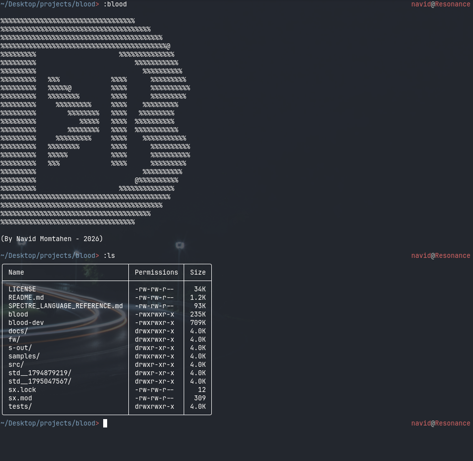

# blood

POSIX shell built for performance, reliability and ergonomics.

Outperforms ksh and dash on several benchmarks, outperforming Elvish and Fish by up to 120x on general purpose tasks as per [Shell Arena](https://navid-m.github.io/shellarena/).

```
for x in ["hello", "world"] {
    shell("cowsay " + x)
}
```

---



---

## Examples

The shell and the language are one. shell commands are values, strings interpolate, and loops hold real data. Thus, there are no quoting layers to get tangled with.

```
fn lines(path) {
    return len(read_file(path).strip().split("\n"))
}
total = 0
for file in glob("src/*.sx") {
    n = lines(file)
    total += n
    say "{file}: {n} lines"
}
say "source total: {total} lines"
```

Note that captured commands are ordinary strings, so you can do:

```
branch = capture("git branch --show-current").strip()
say "working on {branch}"

changes = capture("git status --porcelain").strip()
if changes != "" {
    for change in changes.split("\n") {
        say "  {change}"
    }
}
```

Parallelism is a keyword

Every iteration is a child process. No thread pools or async/await.

```
para for file in glob("src/*.sx") {
    say capture("sha256sum {file}").strip()
}
```

---

&copy; Navid Momtahen - 2026

License: GPL-3.0-only
